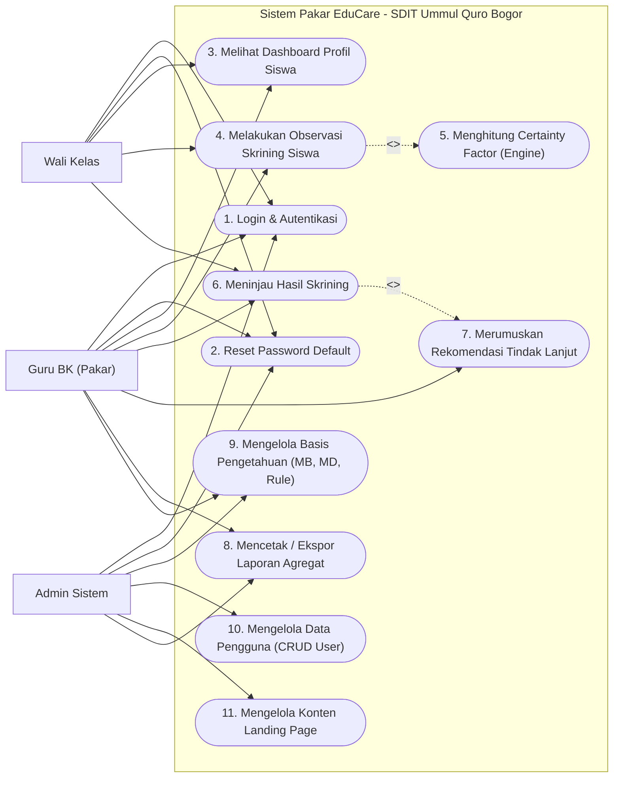
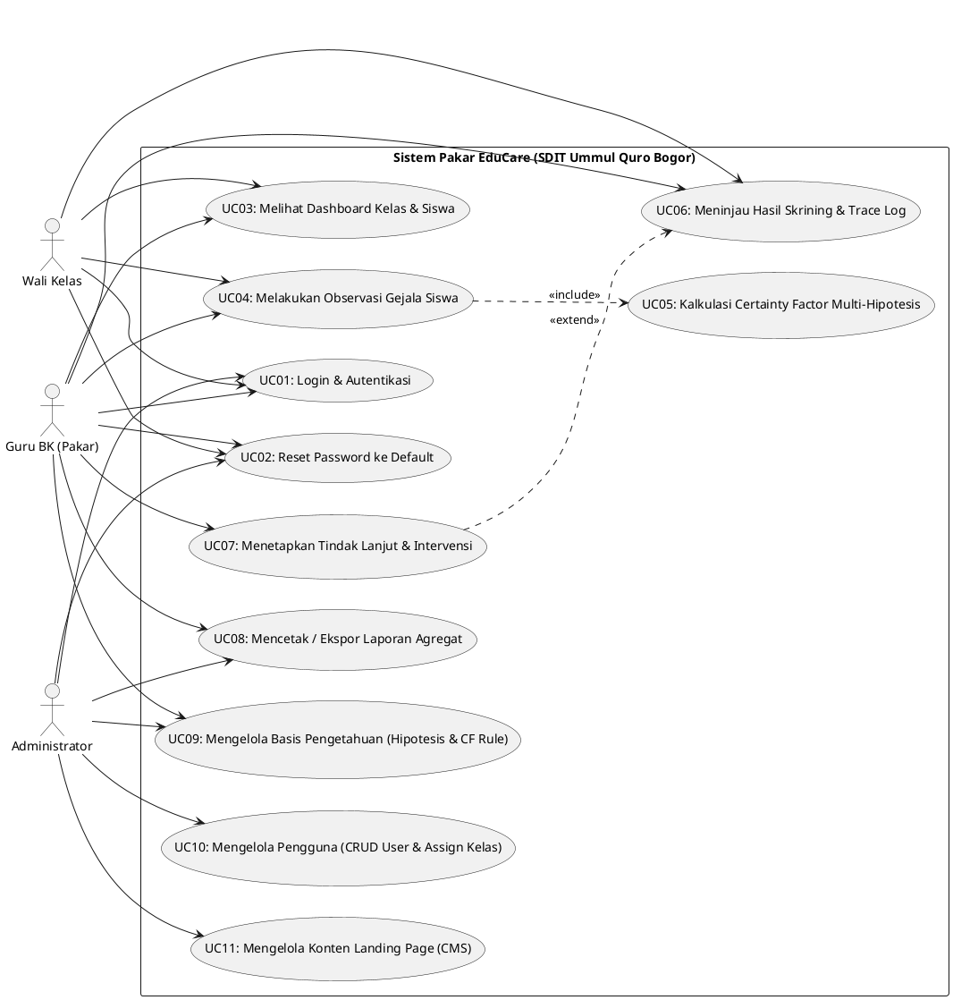
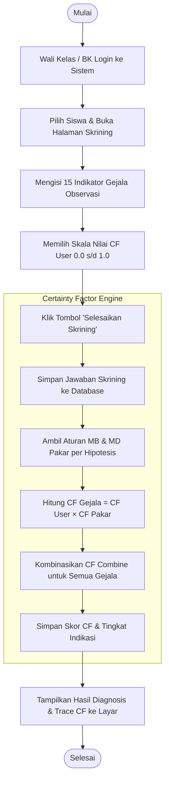
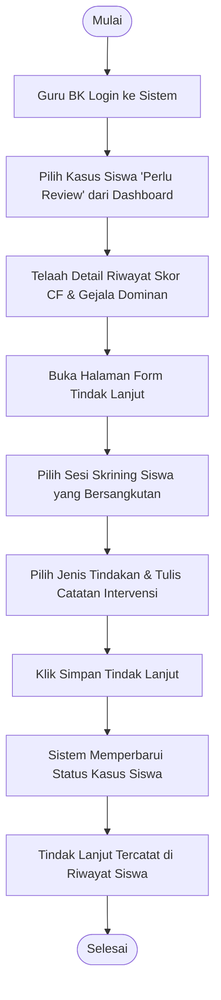
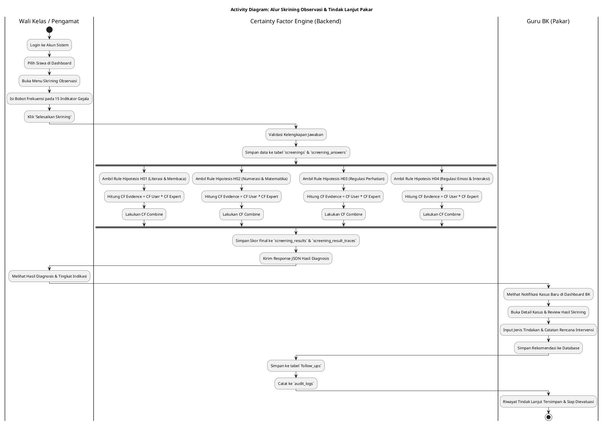
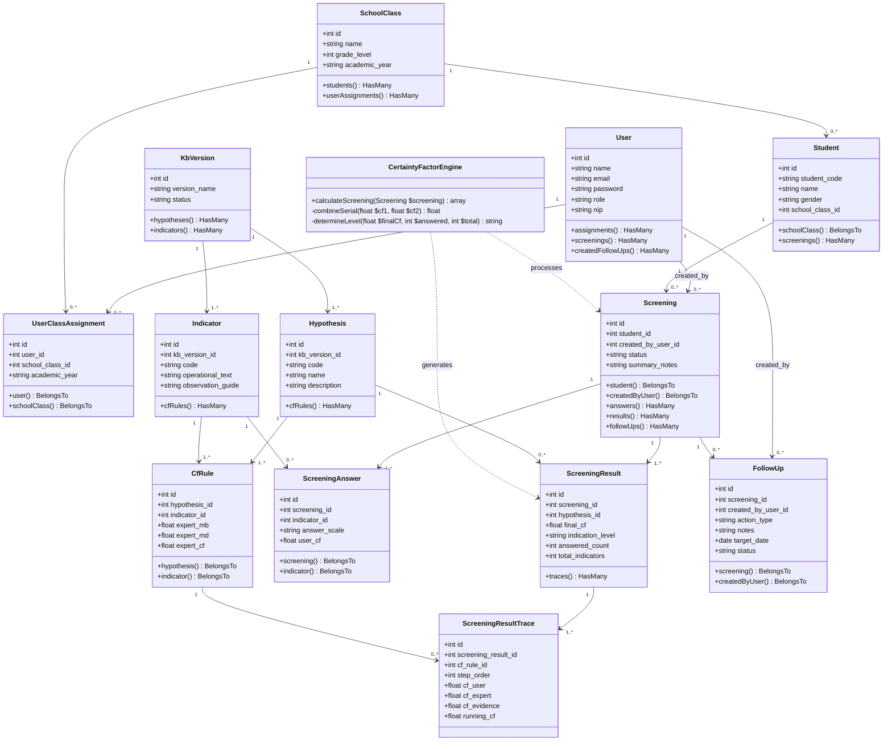
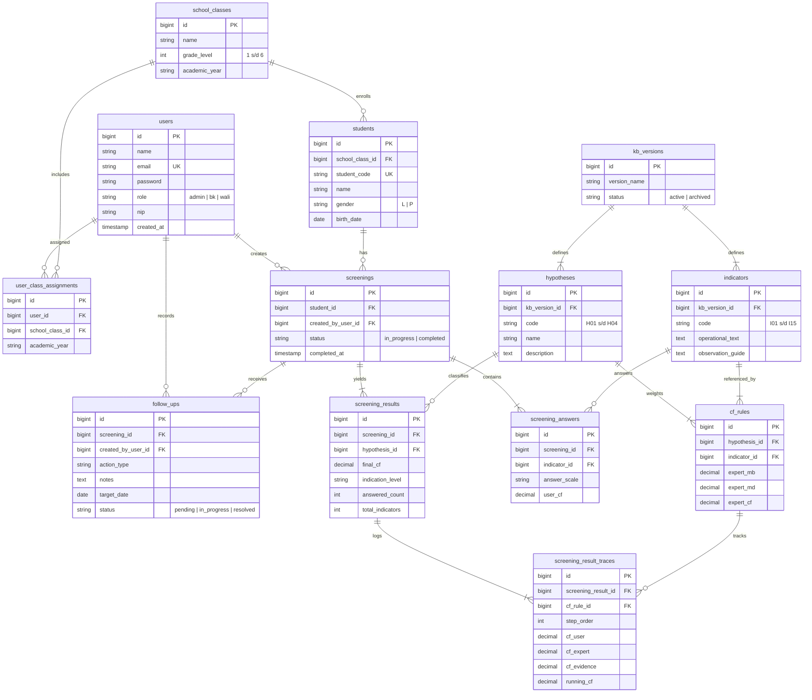

# Dokumentasi Diagram Lengkap Sistem Pakar EduCare (SDIT Ummul Quro Bogor)

Dokumen ini berisi kode representasi diagram permodelan sistem:
1. **Use Case Diagram (PlantUML & Mermaid)**
2. **Activity Diagram (PlantUML & Mermaid)**
3. **Class Diagram (Mermaid & PlantUML)**
4. **Entity Relationship Diagram / ERD (Mermaid & PlantUML)**

---

## 1. Use Case Diagram

Diagram ini merepresentasikan hak akses dan peran dari 3 aktor utama sistem: **Wali Kelas**, **Guru BK (Pakar)**, dan **Admin Sistem**.

### Format Mermaid


### Format PlantUML


---

## 2. Activity Diagram

Diagram aktivitas mencakup 2 alur inti bisnis:
- **Alur Skrining & Inferensi Certainty Factor (Wali Kelas & Sistem)**
- **Alur Tindak Lanjut Intervensi (Guru BK)**

### Format Mermaid: Alur Observasi & Kalkulasi CF


### Format Mermaid: Alur Peninjauan & Intervensi Guru BK


### Format PlantUML: Activity Diagram Lengkap


---

## 3. Class Diagram

Diagram kelas menunjukkan struktur arsitektur OOP backend Laravel, model Eloquent, relasi data, serta service engine inferensi.

### Format Mermaid


---

## 4. Entity Relationship Diagram (ERD)

Diagram ERD relasional fisik database (MySQL / SQLite) yang digunakan oleh sistem.

### Format Mermaid


---

### Cara Menggunakan Kode Diagram di Atas:
1. **GitHub Markdown / VS Code**: Blok dengan kode ```mermaid otomatis dirender menjadi grafik interaktif di GitHub maupun preview editor markdown.
2. **PlantUML**: Salin kode PlantUML ke [PlantText UML Editor](https://www.planttext.com/) atau plugin PlantUML di VS Code/IntelliJ untuk mengekspornya menjadi format gambar PNG/SVG/PDF.
3. **Draw.io**: Diagram Mermaid juga bisa langsung di-import di menu *Arrange > Insert > Advanced > Mermaid*.
