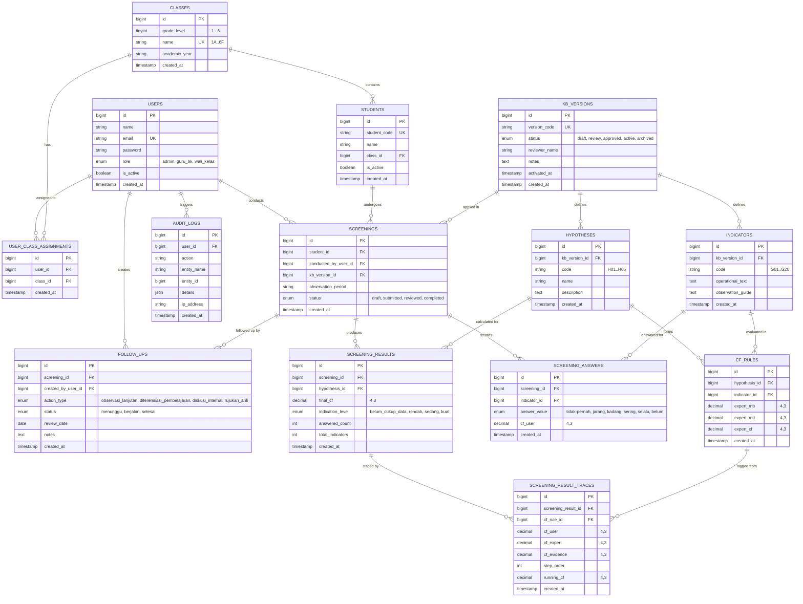

# Rancangan Arsitektur Data: ERD & Class Diagram
**Sistem Pakar Diagnosa Dini Hambatan Belajar Siswa (EduPakar / Rumah Sahabat)**

Dokumen ini memuat perancangan basis data relasional (**Entity-Relationship Diagram / ERD**) dan struktur pemrograman berorientasi objek (**Class Diagram**) berbasis model Laravel dan schema database yang diimplementasikan pada sistem.

---

## 1. Entity-Relationship Diagram (ERD)

Diagram berikut memodelkan seluruh entitas, atribut kunci, relasi kardinalitas, dan kunci asing (*Foreign Key*) pada sistem:



---

## 2. Tabel Kamus Data Relasional (Data Dictionary)

| No | Nama Entitas / Tabel | Fungsi Utama | Kunci Primer (PK) | Kunci Asing (FK) Terpenting |
|---|---|---|---|---|
| 1 | `users` | Akun pengguna sistem (Admin, Guru BK, Wali Kelas) | `id` | - |
| 2 | `classes` | Data rombongan belajar / jenjang kelas (1–6 / Rombel A–F) | `id` | - |
| 3 | `user_class_assignments` | Tabel pivot penugasan Wali Kelas ke rombel kelas | `id` | `user_id`, `class_id` |
| 4 | `students` | Data profil dan kode identifikasi siswa | `id` | `class_id` |
| 5 | `kb_versions` | Versioning basis pengetahuan pakar (aturan CF) | `id` | - |
| 6 | `hypotheses` | Klasifikasi jenis hambatan belajar (H01–H05) | `id` | `kb_version_id` |
| 7 | `indicators` | Gejala/indikator observasi perilaku siswa | `id` | `kb_version_id` |
| 8 | `cf_rules` | Matriks relasi hipotesis-indikator beserta bobot MB & MD pakar | `id` | `hypothesis_id`, `indicator_id` |
| 9 | `screenings` | Sesi pencatatan skrining siswa oleh guru | `id` | `student_id`, `conducted_by_user_id`, `kb_version_id` |
| 10 | `screening_answers` | Nilai observasi skala gejala dari guru (User CF) | `id` | `screening_id`, `indicator_id` |
| 11 | `screening_results` | Nilai akhir Certainty Factor & tingkat indikasi | `id` | `screening_id`, `hypothesis_id` |
| 12 | `screening_result_traces` | Jejak kalkulasi bertahap kombinasi rumus CF ($CF_{combine}$) | `id` | `screening_result_id`, `cf_rule_id` |
| 13 | `follow_ups` | Catatan intervensi & rencana tindak lanjut Guru BK | `id` | `screening_id`, `created_by_user_id` |
| 14 | `audit_logs` | Jejak audit keamanan & rekam jejak aktivitas pengguna | `id` | `user_id` |

---

## 3. Class Diagram (Arsitektur OOP & Service Layer)

Diagram kelas berikut mengilustrasikan struktur kelas domain (Model Eloquent Laravel), dependensi relasi, metode bisnis, serta *Inference Service Engine*:

```mermaid
classDiagram
    direction TB

    class User {
        +int id
        +string name
        +string email
        +string password
        +string role
        +bool is_active
        +isAdmin() bool
        +isGuruBk() bool
        +isWaliKelas() bool
        +hasAccessToClass(classId: int) bool
        +hasAccessToStudent(student: Student) bool
    }

    class SchoolClass {
        +int id
        +int grade_level
        +string name
        +string academic_year
        +students() HasMany
        +users() BelongsToMany
    }

    class Student {
        +int id
        +string student_code
        +string name
        +int class_id
        +bool is_active
        +schoolClass() BelongsTo
        +screenings() HasMany
    }

    class KbVersion {
        +int id
        +string version_code
        +string status
        +string reviewer_name
        +hypotheses() HasMany
        +indicators() HasMany
        +activate() void
    }

    class Hypothesis {
        +int id
        +int kb_version_id
        +string code
        +string name
        +string description
        +cfRules() HasMany
    }

    class Indicator {
        +int id
        +int kb_version_id
        +string code
        +string operational_text
        +string observation_guide
        +cfRules() HasMany
    }

    class CfRule {
        +int id
        +int hypothesis_id
        +int indicator_id
        +float expert_mb
        +float expert_md
        +float expert_cf
        +calculateExpertCf() float
    }

    class Screening {
        +int id
        +int student_id
        +int conducted_by_user_id
        +int kb_version_id
        +string observation_period
        +string status
        +answers() HasMany
        +results() HasMany
        +followUps() HasMany
    }

    class ScreeningAnswer {
        +int id
        +int screening_id
        +int indicator_id
        +string answer_value
        +float cf_user
    }

    class ScreeningResult {
        +int id
        +int screening_id
        +int hypothesis_id
        +float final_cf
        +string indication_level
        +int answered_count
        +int total_indicators
        +traces() HasMany
    }

    class CertaintyFactorEngine {
        +calculateScreening(screening: Screening) array
        -combineCf(cfOld: float, cfNew: float) float
        -mapAnswerToUserCf(answerValue: string) float
        -determineLevel(finalCf: float) string
    }

    class FollowUp {
        +int id
        +int screening_id
        +int created_by_user_id
        +string action_type
        +string status
        +string review_date
        +string notes
    }

    class AuditLog {
        +int id
        +int user_id
        +string action
        +string entity_name
        +int entity_id
        +record(userId, action, entity, entityId, details, ip) void
    }

    User "1" <-- "0..*" Screening : conducts
    User "1" <-- "0..*" FollowUp : creates
    User "0..*" <--> "0..*" SchoolClass : assigned via pivot
    SchoolClass "1" <-- "0..*" Student : has
    Student "1" <-- "0..*" Screening : undergoes
    
    KbVersion "1" <-- "1..*" Hypothesis : contains
    KbVersion "1" <-- "1..*" Indicator : contains
    Hypothesis "1" <-- "1..*" CfRule : defines
    Indicator "1" <-- "1..*" CfRule : assessed in
    
    Screening "1" <-- "1..*" ScreeningAnswer : contains
    Screening "1" <-- "1..*" ScreeningResult : produces
    Screening "1" <-- "0..*" FollowUp : tracks
    
    CertaintyFactorEngine ..> Screening : processes
    CertaintyFactorEngine ..> CfRule : evaluates
    CertaintyFactorEngine ..> ScreeningResult : generates
