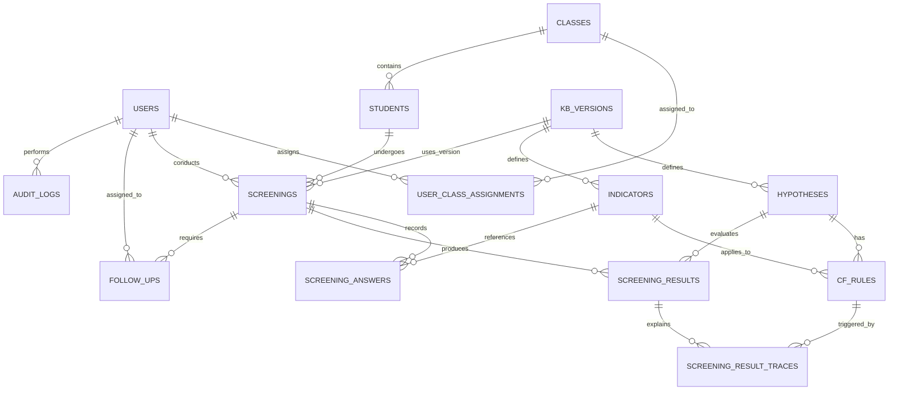

# DOKUMEN ARSITEKTUR & DESAIN DATABASE (PHASE 3)
**Sistem Pakar Diagnosa Dini Hambatan Belajar Siswa Berbasis Web**  
*Studi Kasus: SDIT Ummul Quro Bogor*  
*Status: Phase 3 Blueprint Final*  
*Tanggal: 27 Oktober 2026*  

---

## 1. Pilihan Arsitektur Sistem

Berdasarkan kesuksesan prototype Phase 1 yang telah disetujui, arsitektur sistem yang dipilih adalah:
> **Decoupled Architecture: Single Page Application (Vite + Tailwind CSS + Vanilla JS) + Laravel RESTful API (MySQL 8.0)**

### Keunggulan untuk Fleksibilitas Masa Depan:
1. **Tidak Bergantung Hardcode (Data-Driven Engine):** Seluruh indikator, bobot pakar ($MB/MD$), ambang batas (*threshold*), dan kategori disimpan dalam database. Perubahan metodologi di masa depan dilakukan melalui tabel basis pengetahuan tanpa perlu mengubah logika program.
2. **Riwayat Skrining Terkunci (Version Snapshot):** Setiap sesi skrining merekam snapshot versi aturan yang berlaku (`knowledge_base_version`), sehingga revisi aturan di masa depan tidak akan mengubah hasil skrining masa lalu.
3. **Database Migration Bersih:** Skema database dirancang modular menggunakan Laravel Migrations sehingga penambahan fitur baru di masa mendatang tidak akan merusak data produksi yang sudah ada.

---

## 2. Entity Relationship Diagram (ERD)



---

## 3. Spesifikasi Skema Database Relasional (DDL Spec)

### A. Modul Pengguna & Hak Akses (Auth & Authorization)
```sql
-- 1. users: Akun pengguna internal (Admin, Guru BK, Wali Kelas)
CREATE TABLE users (
    id BIGINT UNSIGNED AUTO_INCREMENT PRIMARY KEY,
    name VARCHAR(150) NOT NULL,
    email VARCHAR(191) NOT NULL UNIQUE,
    password VARCHAR(255) NOT NULL,
    role ENUM('admin', 'guru_bk', 'wali_kelas') NOT NULL,
    is_active BOOLEAN DEFAULT TRUE,
    created_at TIMESTAMP NULL,
    updated_at TIMESTAMP NULL
);

-- 2. classes: Rombongan belajar / kelas SDIT Ummul Quro
CREATE TABLE classes (
    id BIGINT UNSIGNED AUTO_INCREMENT PRIMARY KEY,
    grade_level TINYINT UNSIGNED NOT NULL, -- 1 sampai 6
    name VARCHAR(50) NOT NULL UNIQUE,      -- contoh: '3A', '4B'
    academic_year VARCHAR(20) NOT NULL,    -- contoh: '2026/2027'
    created_at TIMESTAMP NULL,
    updated_at TIMESTAMP NULL
);

-- 3. user_class_assignments: Pembatasan cakupan kelas bagi Wali Kelas
CREATE TABLE user_class_assignments (
    id BIGINT UNSIGNED AUTO_INCREMENT PRIMARY KEY,
    user_id BIGINT UNSIGNED NOT NULL,
    class_id BIGINT UNSIGNED NOT NULL,
    created_at TIMESTAMP NULL,
    FOREIGN KEY (user_id) REFERENCES users(id) ON DELETE CASCADE,
    FOREIGN KEY (class_id) REFERENCES classes(id) ON DELETE CASCADE,
    UNIQUE KEY uq_user_class (user_id, class_id)
);
```

### B. Modul Siswa (Data Minimization First)
```sql
-- 4. students: Data siswa terpseudonim (hanya data minimum esensial)
CREATE TABLE students (
    id BIGINT UNSIGNED AUTO_INCREMENT PRIMARY KEY,
    student_code VARCHAR(50) NOT NULL UNIQUE, -- ID Internal Sekolah
    name VARCHAR(150) NOT NULL,               -- Nama tampilan untuk identifikasi guru
    class_id BIGINT UNSIGNED NOT NULL,
    is_active BOOLEAN DEFAULT TRUE,
    created_at TIMESTAMP NULL,
    updated_at TIMESTAMP NULL,
    FOREIGN KEY (class_id) REFERENCES classes(id) ON DELETE RESTRICT
);
```

### C. Modul Basis Pengetahuan & Versioning Aturan CF
```sql
-- 5. kb_versions: Versi basis pengetahuan (mendukung fleksibilitas & perubahan mendatang)
CREATE TABLE kb_versions (
    id BIGINT UNSIGNED AUTO_INCREMENT PRIMARY KEY,
    version_code VARCHAR(20) NOT NULL UNIQUE, -- contoh: 'v1.0-RC', 'v1.1'
    status ENUM('draft', 'review', 'approved', 'active', 'archived') NOT NULL DEFAULT 'draft',
    reviewer_name VARCHAR(150) NULL,
    notes TEXT NULL,
    activated_at TIMESTAMP NULL,
    created_at TIMESTAMP NULL,
    updated_at TIMESTAMP NULL
);

-- 6. hypotheses: Kategori indikasi edukatif
CREATE TABLE hypotheses (
    id BIGINT UNSIGNED AUTO_INCREMENT PRIMARY KEY,
    kb_version_id BIGINT UNSIGNED NOT NULL,
    code VARCHAR(20) NOT NULL,         -- contoh: 'H01', 'H02'
    name VARCHAR(150) NOT NULL,        -- contoh: 'Indikasi Hambatan Literasi & Membaca Dasar'
    description TEXT NULL,
    created_at TIMESTAMP NULL,
    updated_at TIMESTAMP NULL,
    FOREIGN KEY (kb_version_id) REFERENCES kb_versions(id) ON DELETE CASCADE,
    UNIQUE KEY uq_kb_hypo (kb_version_id, code)
);

-- 7. indicators: Indikator observasi perilaku
CREATE TABLE indicators (
    id BIGINT UNSIGNED AUTO_INCREMENT PRIMARY KEY,
    kb_version_id BIGINT UNSIGNED NOT NULL,
    code VARCHAR(20) NOT NULL,         -- contoh: 'I01', 'I02'
    operational_text TEXT NOT NULL,    -- teks definisi perilaku teramati
    observation_guide TEXT NULL,       -- panduan pengamatan guru
    created_at TIMESTAMP NULL,
    updated_at TIMESTAMP NULL,
    FOREIGN KEY (kb_version_id) REFERENCES kb_versions(id) ON DELETE CASCADE,
    UNIQUE KEY uq_kb_ind (kb_version_id, code)
);

-- 8. cf_rules: Hubungan Hipotesis dengan Indikator beserta bobot pakar (MB/MD)
CREATE TABLE cf_rules (
    id BIGINT UNSIGNED AUTO_INCREMENT PRIMARY KEY,
    hypothesis_id BIGINT UNSIGNED NOT NULL,
    indicator_id BIGINT UNSIGNED NOT NULL,
    expert_mb DECIMAL(4, 3) NOT NULL,  -- Measure of Belief (0.000 - 1.000)
    expert_md DECIMAL(4, 3) NOT NULL,  -- Measure of Disbelief (0.000 - 1.000)
    expert_cf DECIMAL(4, 3) NOT NULL,  -- MB - MD
    created_at TIMESTAMP NULL,
    updated_at TIMESTAMP NULL,
    FOREIGN KEY (hypothesis_id) REFERENCES hypotheses(id) ON DELETE CASCADE,
    FOREIGN KEY (indicator_id) REFERENCES indicators(id) ON DELETE CASCADE,
    UNIQUE KEY uq_hypo_ind (hypothesis_id, indicator_id)
);
```

### D. Modul Skrining, Kalkulasi CF & Traceability
```sql
-- 9. screenings: Sesi pengamatan / skrining
CREATE TABLE screenings (
    id BIGINT UNSIGNED AUTO_INCREMENT PRIMARY KEY,
    student_id BIGINT UNSIGNED NOT NULL,
    conducted_by_user_id BIGINT UNSIGNED NOT NULL,
    kb_version_id BIGINT UNSIGNED NOT NULL,
    observation_period VARCHAR(50) NOT NULL, -- contoh: 'Oktober 2026'
    status ENUM('draft', 'submitted', 'reviewed', 'completed') DEFAULT 'submitted',
    created_at TIMESTAMP NULL,
    updated_at TIMESTAMP NULL,
    FOREIGN KEY (student_id) REFERENCES students(id) ON DELETE RESTRICT,
    FOREIGN KEY (conducted_by_user_id) REFERENCES users(id) ON DELETE RESTRICT,
    FOREIGN KEY (kb_version_id) REFERENCES kb_versions(id) ON DELETE RESTRICT
);

-- 10. screening_answers: Jawaban observasi per indikator
CREATE TABLE screening_answers (
    id BIGINT UNSIGNED AUTO_INCREMENT PRIMARY KEY,
    screening_id BIGINT UNSIGNED NOT NULL,
    indicator_id BIGINT UNSIGNED NOT NULL,
    answer_value ENUM('tidak-pernah', 'jarang', 'kadang', 'sering', 'selalu', 'belum') NOT NULL,
    cf_user DECIMAL(4, 3) NULL, -- NULL jika 'belum' (belum diamati)
    FOREIGN KEY (screening_id) REFERENCES screenings(id) ON DELETE CASCADE,
    FOREIGN KEY (indicator_id) REFERENCES indicators(id) ON DELETE RESTRICT,
    UNIQUE KEY uq_screen_ind (screening_id, indicator_id)
);

-- 11. screening_results: Hasil skor CF per kategori hipotesis
CREATE TABLE screening_results (
    id BIGINT UNSIGNED AUTO_INCREMENT PRIMARY KEY,
    screening_id BIGINT UNSIGNED NOT NULL,
    hypothesis_id BIGINT UNSIGNED NOT NULL,
    final_cf DECIMAL(4, 3) NULL, -- NULL jika data < 50%
    indication_level ENUM('belum_cukup_data', 'rendah', 'sedang', 'kuat') NOT NULL,
    answered_count INT UNSIGNED NOT NULL,
    total_indicators INT UNSIGNED NOT NULL,
    FOREIGN KEY (screening_id) REFERENCES screenings(id) ON DELETE CASCADE,
    FOREIGN KEY (hypothesis_id) REFERENCES hypotheses(id) ON DELETE RESTRICT,
    UNIQUE KEY uq_screen_hypo (screening_id, hypothesis_id)
);

-- 12. screening_result_traces: Audit detail inferensi (kenapa nilai CF dihasilkan)
CREATE TABLE screening_result_traces (
    id BIGINT UNSIGNED AUTO_INCREMENT PRIMARY KEY,
    screening_result_id BIGINT UNSIGNED NOT NULL,
    cf_rule_id BIGINT UNSIGNED NOT NULL,
    cf_user DECIMAL(4, 3) NOT NULL,
    cf_expert DECIMAL(4, 3) NOT NULL,
    cf_evidence DECIMAL(4, 3) NOT NULL, -- cf_user * cf_expert
    step_order INT UNSIGNED NOT NULL,
    running_cf DECIMAL(4, 3) NOT NULL,  -- akumulasi kombinasi berurutan
    FOREIGN KEY (screening_result_id) REFERENCES screening_results(id) ON DELETE CASCADE,
    FOREIGN KEY (cf_rule_id) REFERENCES cf_rules(id) ON DELETE RESTRICT
);
```

### E. Modul Tindak Lanjut & Audit Log
```sql
-- 13. follow_ups: Rekomendasi dan catatan tindak lanjut edukatif
CREATE TABLE follow_ups (
    id BIGINT UNSIGNED AUTO_INCREMENT PRIMARY KEY,
    screening_id BIGINT UNSIGNED NOT NULL,
    created_by_user_id BIGINT UNSIGNED NOT NULL,
    action_type ENUM('observasi_lanjutan', 'diferensiasi_pembelajaran', 'diskusi_internal', 'rujukan_ahli') NOT NULL,
    status ENUM('menunggu', 'berjalan', 'selesai') DEFAULT 'menunggu',
    review_date DATE NULL,
    notes TEXT NOT NULL,
    created_at TIMESTAMP NULL,
    updated_at TIMESTAMP NULL,
    FOREIGN KEY (screening_id) REFERENCES screenings(id) ON DELETE CASCADE,
    FOREIGN KEY (created_by_user_id) REFERENCES users(id) ON DELETE RESTRICT
);

-- 14. audit_logs: Rekaman aktivitas penting sistem (keamanan & integritas data)
CREATE TABLE audit_logs (
    id BIGINT UNSIGNED AUTO_INCREMENT PRIMARY KEY,
    user_id BIGINT UNSIGNED NULL,
    action VARCHAR(100) NOT NULL,      -- contoh: 'CREATE_SCREENING', 'ACTIVATE_KB_VERSION'
    entity_name VARCHAR(100) NOT NULL, -- contoh: 'screenings', 'kb_versions'
    entity_id BIGINT UNSIGNED NULL,
    details JSON NULL,
    ip_address VARCHAR(45) NULL,
    created_at TIMESTAMP NOT NULL DEFAULT CURRENT_TIMESTAMP,
    FOREIGN KEY (user_id) REFERENCES users(id) ON DELETE SET NULL
);
```

---

## 4. Kebijakan Keamanan, Akses (RBAC) & Privasi Data

| Role | Cakupan Akses Data Siswa | Kewenangan Skrining | Pengelolaan Basis Pengetahuan |
| :--- | :--- | :--- | :--- |
| **Wali Kelas** | Terbatas pada siswa di kelas yang ditugaskan kepadanya (`user_class_assignments`). | Boleh membuat draf observasi & melihat tindak lanjut kelasnya. | Hanya melihat indikator aktif (*Read-Only*). |
| **Guru BK** | Melihat seluruh siswa yang memerlukan skrining/tinjauan (*School-Wide Counseling Scope*). | Boleh memverifikasi observasi, menghitung hasil CF, dan menulis tindak lanjut. | Memberikan review/masukan pada aturan (*Reviewer*). |
| **Admin** | Pengaturan sistem, manajemen akun guru, dan jejak audit. Tidak melihat catatan konseling sensitif. | Tidak menjalankan skrining siswa. | Mengelola versi basis pengetahuan, mengaktifkan versi terverifikasi (*Full Admin*). |

---

## 5. Ringkasan Kesiapan Menuju Phase 4 (Backend Implementation)

Dengan diselesaikannya blueprint Phase 3 ini:
1. **ERD & DDL SQL** sudah terdefinisi secara presisi.
2. **Keterlacakan (*Traceability*)** hasil inferensi CF dijamin melalui tabel `screening_result_traces`.
3. **Fleksibilitas Masa Depan** terlindungi 100% oleh skema `kb_versions`, `hypotheses`, `indicators`, dan `cf_rules`.
