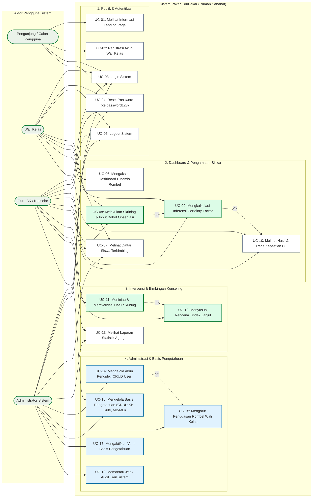

# Use Case Diagram & Dokumentasi Spesifikasi Terkini
**Sistem Pakar Diagnosa Dini Hambatan Belajar Siswa (EduPakar / Rumah Sahabat)**
*SDIT & SMPIT Ummul Quro Bogor — Edisi Pembaruan 2026*

Dokumen ini memuat kode diagram **Mermaid (Use Case Diagram)**, tabel pemetaan aktor terhadap use case, dan deskripsi tekstual (*use case specification*) yang telah mencakup seluruh fitur terbaru:
1. **Landing Page EduPakar Publik**
2. **Autentikasi & Reset Password Otomatis ke Default (`password123`)**
3. **Manajemen Akun Pendidik (CRUD Pengguna & Hak Akses di Sidebar Admin)**
4. **Dashboard Dinamis Wali Kelas (Sesuai Rombel Kelas 1A–6F yang Diampu)**
5. **Observasi & Inferensi Skrining Certainty Factor (Guru BK & Wali Kelas)**
6. **Validasi & Rencana Tindak Lanjut Intervensi Edukatif (Guru BK)**
7. **Pengelolaan Basis Pengetahuan & Rule Base Pakar (Admin & Guru BK)**
8. **Laporan Agregat Anonim & Audit Trail Keamanan**

---

## 1. Kode Diagram Mermaid (Use Case Diagram)

Kode berikut dapat dirender langsung di Markdown viewer, VS Code Mermaid Preview, maupun platform dokumentasi lainnya:

---

## 2. Tabel Matriks Hak Akses Aktor (Actor vs Use Case)

| ID | Nama Use Case | Pengunjung / Tamu | Wali Kelas | Guru BK | Administrator |
|:---:|:---|:---:|:---:|:---:|:---:|
| **UC-01** | Melihat Informasi Landing Page | ✅ | ✅ | ✅ | ✅ |
| **UC-02** | Registrasi Akun Wali Kelas | ✅ | - | - | - |
| **UC-03** | Login Sistem | - | ✅ | ✅ | ✅ |
| **UC-04** | Reset Password (ke `password123`) | ✅ | ✅ | ✅ | ✅ |
| **UC-05** | Logout Sistem | - | ✅ | ✅ | ✅ |
| **UC-06** | Mengakses Dashboard Dinamis Rombel | - | ✅ *(Scoped)* | - | - |
| **UC-07** | Melihat Daftar Siswa Terbimbing | - | ✅ *(Kelasnya)* | ✅ *(Semua)* | ✅ *(Semua)* |
| **UC-08** | Melakukan Skrining & Input Bobot Observasi | - | ✅ *(Siswa Kelas)* | ✅ *(Semua Siswa)* | - |
| **UC-09** | Mengkalkulasi Inferensi Certainty Factor | - | ✅ | ✅ | - |
| **UC-10** | Melihat Hasil & Trace Kepastian CF | - | ✅ | ✅ | ✅ |
| **UC-11** | Meninjau & Memvalidasi Hasil Skrining | - | - | ✅ | - |
| **UC-12** | Menyusun Rencana Tindak Lanjut Intervensi | - | - | ✅ | - |
| **UC-13** | Melihat Laporan Statistik Agregat | - | - | ✅ | ✅ |
| **UC-14** | Manajemen Akun Pendidik (CRUD User) | - | - | - | ✅ |
| **UC-15** | Mengatur Penugasan Rombel Wali Kelas | - | - | - | ✅ |
| **UC-16** | Mengelola Basis Pengetahuan (CRUD KB & Rule) | - | - | ✅ | ✅ |
| **UC-17** | Mengaktifkan Versi Basis Pengetahuan | - | - | - | ✅ |
| **UC-18** | Memantau Jejak Audit Trail Sistem | - | - | - | ✅ |

---

## 3. Spesifikasi Rinci Use Case Utama (Use Case Detail)

### UC-04: Lupa & Reset Kata Sandi
- **Aktor Utama**: Pengguna Terdaftar (Semua Role).
- **Deskripsi**: Mengembalikan kata sandi akun pengguna yang lupa ke nilai bawaan (*default*).
- **Pra-kondisi**: Pengguna berada di halaman login dan memiliki surel yang terdaftar.
- **Alur Utama**:
  1. Pengguna menekan tombol/tautan *"Lupa Kata Sandi?"* pada formulir login.
  2. Sistem menampilkan modal popup formulir lupa kata sandi.
  3. Pengguna memasukkan alamat surel akun terdaftarnya dan menekan *"Reset Kata Sandi"*.
  4. Sistem memverifikasi ketersediaan surel di basis data `users`.
  5. Sistem mengenkripsi kata sandi baru (`password123`) dan menyimpannya.
  6. Sistem mencatat rekam audit (`RESET_PASSWORD_DEFAULT`).
  7. Sistem menampilkan notifikasi sukses dan otomatis mengisikan kata sandi baru ke formulir login.
- **Pascakondisi**: Pengguna dapat langsung login kembali menggunakan kata sandi `password123`.

### UC-06: Mengakses Dashboard Dinamis Rombel
- **Aktor Utama**: Wali Kelas.
- **Deskripsi**: Menampilkan dashboard pemantauan yang namanya dan daftar siswanya otomatis menyesuaikan dengan rombel penugasan pengguna yang sedang login.
- **Pra-kondisi**: Pengguna berhasil terotentikasi sebagai `wali_kelas`.
- **Alur Utama**:
  1. Pengguna membuka menu Dashboard.
  2. Sistem membaca token sesi dan mendeteksi ID rombel yang ditugaskan (contoh: Kelas 4A).
  3. Sistem mengubah judul menjadi *"Dashboard Kelas 4A"* dan menampilkan sapaan personal.
  4. Sistem mengambil data metrik, rekap observasi, dan daftar siswa khusus rombel tersebut.
  5. Jika wali kelas mengampu lebih dari satu rombel, sistem menampilkan tombol pemilih (*selector*) rombel aktif.

### UC-08 & UC-09: Skrining & Inferensi Certainty Factor
- **Aktor Utama**: Wali Kelas & Guru BK.
- **Deskripsi**: Menginput 20 indikator observasi perilaku siswa selama 4–8 minggu dan menghitung tingkat kepastian hambatan belajar.
- **Pra-kondisi**: Siswa berada dalam kewenangan akses kelas aktor, dan terdapat versi basis pengetahuan aktif.
- **Alur Utama**:
  1. Aktor memilih siswa dan menentukan periode observasi.
  2. Sistem menyajikan daftar indikator gejala terstandar.
  3. Aktor memberikan skala penilaian keyakinan pengamatan ($CF_{user}$: *Tidak Pernah* s.d. *Selalu*, atau *Belum Diamati*).
  4. Sistem mengevaluasi aturan pakar ($CF_{pakar} = MB - MD$).
  5. Sistem menghitung $CF_{evidence} = CF_{user} \times CF_{pakar}$.
  6. Sistem menjalankan fungsi kombinasi bertahap ($CF_{combine}$) untuk setiap hipotesis hambatan ($H01$ s.d. $H05$).
  7. Sistem menyimpan dan menampilkan kesimpulan indikasi (*Belum Cukup Data, Rendah, Sedang, Kuat*).

### UC-14: Manajemen Akun Pendidik (CRUD Pengguna)
- **Aktor Utama**: Administrator.
- **Deskripsi**: Mengelola seluruh data pengguna sistem melalui menu sidebar khusus tanpa mengganggu layout dashboard utama.
- **Pra-kondisi**: Pengguna terotentikasi sebagai `admin`.
- **Alur Utama**:
  1. Administrator membuka menu *"Kelola Pengguna"* pada sidebar.
  2. Sistem menampilkan tabel daftar seluruh staf pendidik, peran, rombel yang diampu, dan status akun.
  3. Administrator dapat:
     - **Create**: Menambah pendidik baru beserta kata sandi dan penugasan kelas.
     - **Read**: Mencari berdasarkan nama/email dan memfilter berdasarkan peran.
     - **Update**: Memperbarui informasi profil, mengganti kelas ampunan, menonaktifkan akun, atau mengganti kata sandi.
     - **Delete**: Menghapus akun (sistem memblokir admin menghapus akunnya sendiri).
  4. Setiap tindakan terekam pada tabel `audit_logs`.

